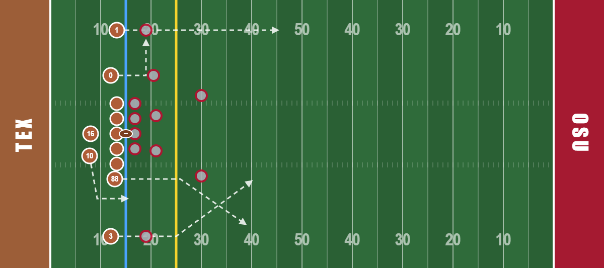
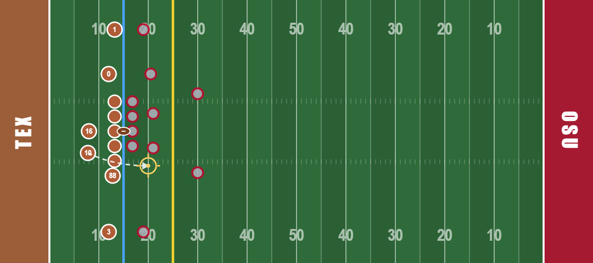
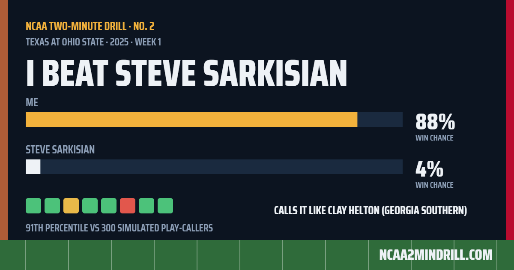

# NCAA Two-Minute Drill — marketing brief

Paste the text below the line into Grok, and attach the four pictures in `marketing/` (or whatever shots you take yourself).

---

You write marketing for **NCAA Two-Minute Drill** (ncaa2mindrill.com), a free daily college football game. Only say true things from this brief; ask if you need a fact that isn't here.

**The game, in one breath.** Each day you take over one real late-game FBS drive from 2023–2025: real score, clock, field position, timeouts, players. You call every snap (runs with direction or a tapped hole, a full route tree for every receiver, play action, screens, spikes, timeouts, tempo). Every result is drawn from a real college snap of that type; every snap is animated on the field with big-play popups. At the end you're scored against the real head coach who called that drive, graded snap by snap, ranked against 300 simulated play-callers, and told which real FBS coach you call it like. One share card per result. Saban mode (≤10% to win, or two scores down) and Cignetti mode (10–25% to win) are extra daily drives; in the app they're one $0.99 unlock. Fan-made, not affiliated with anyone.

**Voice.** Dry, literal, deadpan. Jokes land on the user, the moment, or football — never on a real coach or player. No hype, no fake numbers, no emoji except the grade squares in share text. Match these lines from the game:
- "The offensive line would like to be excluded from this narrative."
- "Incomplete. The clock stops for this, per rule 3-3-2, roughly."
- "You out-called James Franklin. He has a staff. You have a browser."

**Audiences.** CFB Twitter/X (reply under viral late-game clips: "we have that drive, go call it better"); r/CFB (one honest builder post, then show up with the exact drive after wild finishes); team subreddits on the day their team is the daily; group chats (the share card is the product there); daily-puzzle people.

**Produce:**
1. 30 X post templates under 240 chars with slots `{away} at {home}, {year}`, `{coach}`, `{down by N}, {clock} left`; half one-liners, half questions ("3rd and 8 from the 41, down 4, 0:38 left, one timeout. What's the call?").
2. 10 reply templates for viral late-game clips (helpful fan, link once).
3. One r/CFB launch post, 200–300 words, written as the builder, with honest caveats (it's a model; players rated by season EPA).
4. An 8-post X launch thread.
5. App Store subtitle (30 chars), promo text (170), description (opening 3 lines must sell), 5 keywords; Google Play short description (80).
6. 15 share-card captions across beat / even / lost, backbone "I beat {coach} {me}–{coach}".
7. A 4-week in-season content calendar (Tuesday: last weekend's drive is today's daily; Saturday: live replies; Sunday: "call it better").

**Links.** Game https://ncaa2mindrill.com · App page https://ncaa2mindrill.com/app · Store links `[add when approved]` · Launch `[date]`.

**Never:** claim affiliation; invent users, ratings, quotes or press; buy or fake engagement; joke about a named coach or player; tag coaches.
